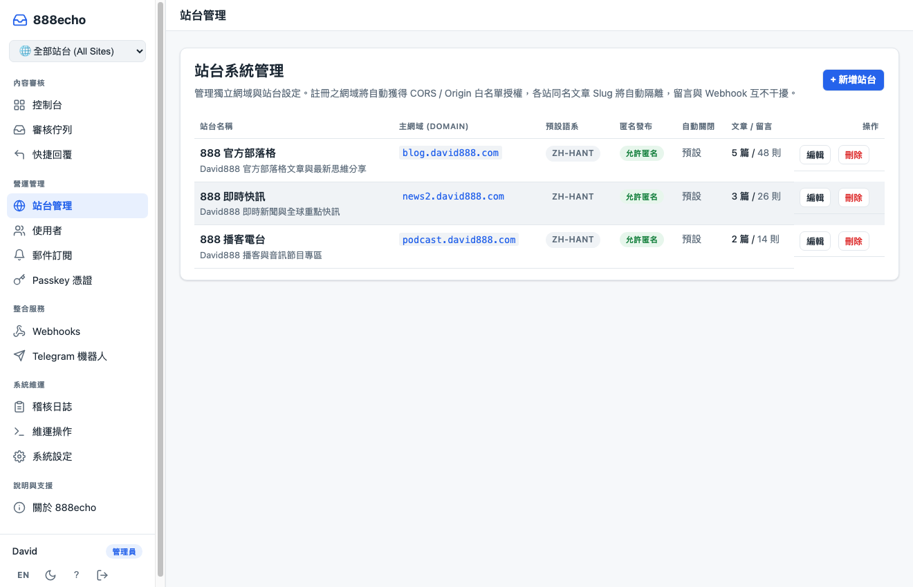
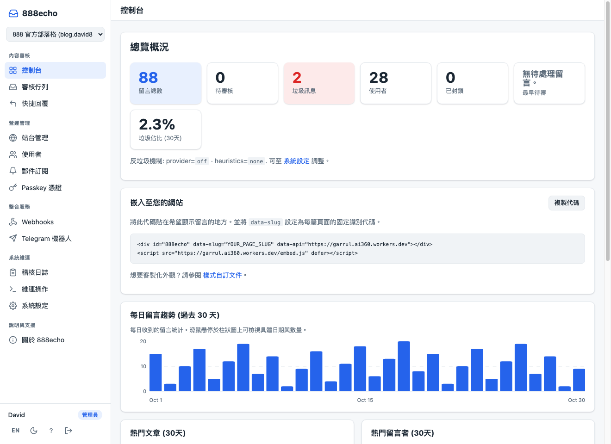
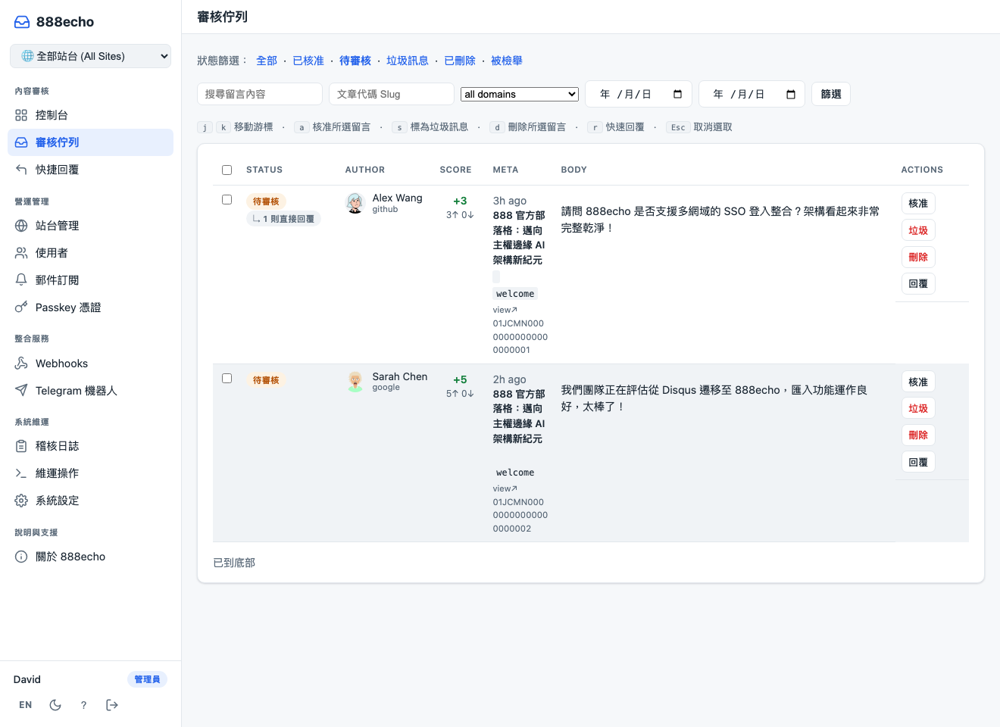
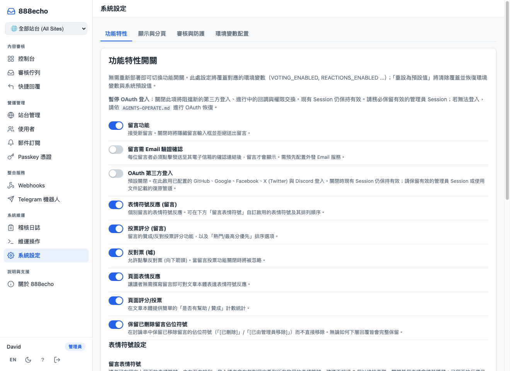
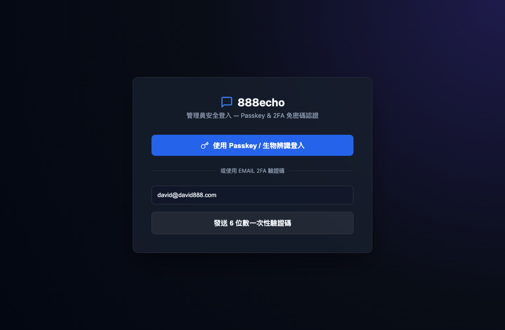

# 888echo

[](LICENSE)
[](https://github.com/tbdavid2019/Garrul/releases)
[](https://github.com/tbdavid2019/Garrul)
[](https://github.com/tbdavid2019/Garrul)

**English** | [繁體中文](README.zh-Hant.md)

**888echo** is a high-performance, sovereign edge comment & discussion engine built on Cloudflare
Workers + D1 + KV + Turnstile. A core pillar of the 888 ecosystem (`888echo`, `888box`, `888a2a`, `888quant`).
Self-hosted, tracker-free, zero per-comment cost, and your data stays 100% in your own Cloudflare account.

Self-hosted, but without the operational friction: **no Docker containers, no VPS, and
no database server maintenance**. Zero OS patching, zero downtime worries, no manual TLS renewals,
and Cloudflare maintains automatic point-in-time backups of D1 SQLite storage.

- **System-Level Multi-Site Architecture**: Serve multiple distinct websites, domains, and subdomains
  (e.g., blogs, news portals, podcasts, documentation) from a single Worker deployment. Features clean
  slug namespacing, dynamic CORS & Origin authorization, site-scoped webhook dispatching, and a global
  site-filtering switcher in the Admin Console.
- **Threaded comments**: Markdown formatting, emoji reactions, edit/delete window, and
  chronological / top-voted sort readers can switch
- **Zero-Trust Admin Login**: Passkey (WebAuthn / Touch ID / Face ID) passwordless authentication,
  plus Email 6-digit OTP verification codes at `/admin/login`
- **OAuth & Anonymous Posting**: Sign in with GitHub, Google, Facebook, X, or Discord, or post
  anonymously protected by Cloudflare Turnstile & rate limiting
- **Dual Container Compatibility**: Embed using `<div id="888echo">` or retain backward
  compatibility with `<div id="garrul">`
- **Real-Time Moderation Alerts**: Integrated Discord webhook dual-backup notifications, Slack,
  Telegram operator bot, and email digests
- **Shadow-DOM Isolated Widget**: Under 30 KB gzipped, themeable with CSS custom properties,
  zero styling bleed into host sites
- **Layered Anti-Spam Architecture**: Turnstile challenges, token minting heuristics, rate-limiting,
  strict HTML sanitization, and muted-word dictionaries
- **Import from Disqus, Remark42, Comentario, isso or Cusdis**: upload the
  export in the admin UI — the `.xml.gz` Disqus hands you, the
  `userbackup-<site>-<ts>.gz` Remark42 writes nightly, or Comentario's JSON
  export, no unzipping — or run
  `npm run import-disqus -- ./export.xml.gz --dry-run` /
  `npm run import-remark42 -- ./userbackup.gz --dry-run` /
  `npm run import-comentario -- ./export.json --dry-run` first. The Comentario
  reader also takes a legacy Commento export. isso and Cusdis ship no export
  at all, so they're two steps — `npm run dump-isso -- ./comments.db --out
  dump.json` or `npm run dump-cusdis -- ./db.sqlite --out dump.json` to read
  the SQLite store, then either `npm run import-isso` / `npm run
  import-cusdis -- ./dump.json --dry-run` or upload that same `dump.json` on
  the admin UI same as the other sources (see
  [`docs/importing.md`](docs/importing.md)). Idempotent, so a re-run inserts
  nothing; closed threads stay closed and spam stays out of the public tree
- **Admin UI**: moderation queue, user management, and settings you
  change without a redeploy
- **RSS feeds**, comment counts, permalinks
- **Webhook out** on every comment event: generic, Slack, Discord, or
  Telegram
- **Telegram operator bot**: moderate from your phone with inline
  buttons, `/queue` and `/stats`, optional daily digest
- **Pinned comments** — moderators pin one top-level comment per post; it
  shows first on page one
- **Staff badge** — moderators and admins can mark a comment as posted by
  staff; the label is configurable
- **Choose your reactions** — pick which of 12 reaction emoji appear on
  comments and on the page bar, in any order
- **Reactions-only mount** — `data-mode="reactions"` renders just the page
  reaction/vote bar, in one request
- **Full-site export** — admins download every post, comment and user as
  JSON, or comments as CSV
- **One-command install** — `npm run setup` asks two questions, then creates
  resources, secrets and the hostname, migrates, deploys and checks health

Every doc in the repo, grouped by task:
[`docs/README.md`](docs/README.md).

## Screenshots

<div align="center">

### 💬 Embedded Comment Widget (Shadow DOM)


*The 888echo widget in action — reaction bar, rich markdown editor, nested discussion thread, and native Traditional Chinese localization.*

<br>

### 🌐 System-Level Multi-Site Management


*888echo Multi-Site System Management — isolated domains, custom policies, and multi-tenant tracking.*

<br>

### 📊 Administrative Console & Dashboard


*888echo Administrative Console — Overview metrics, embed code snippet, domain distribution, and 30-day volume.*

<br>

### 🛡️ Moderation Queue


*Audit-grade moderation queue — pending/spam classification, batch approvals, reader reports.*

<br>

### ⚙️ System Settings & Dynamic Feature Toggles


*Fine-grained feature toggles, anti-spam thresholds, display rules, and moderation policies without redeployment.*

<br>

### 🔐 Zero-Trust Passkey Login Portal


*Passwordless authentication with Touch ID, Face ID, Windows Hello, and Email 2FA OTP codes.*

</div>

More, including dark mode, mobile, and the rest of the admin UI:
[`docs/screenshots.md`](docs/screenshots.md).

## Architecture

One Worker serves the widget, the API and the admin UI; a cron pass on the
same Worker sends notifications:

<picture>
  <source media="(prefers-color-scheme: dark)" srcset="docs/screenshots/architecture-dark.webp">
  
</picture>

The Worker, cron handler, D1, KV and edge cache run in your Cloudflare
account; everything else is an outside service. Component-by-component notes:
[`docs/architecture.md`](docs/architecture.md).

## Install

Deploying to production takes ~20 minutes the first time, and then
`npm run upgrade` per release: one command with a `--dry-run` that prints
its plan before touching anything. That is the whole maintenance story;
there is no OS to patch and no service to restart.

The step-by-step guide covers prerequisites, OAuth setup, Turnstile,
custom domain, remote migrations, deploy and smoke test:
[`INSTALL.md`](INSTALL.md). Upgrades are in
[`INSTALL.md#updating`](INSTALL.md#updating).

**Want to try it first? No Cloudflare account needed.**
`.dev.vars.example` ships working dev defaults, including Cloudflare's
"always passes" Turnstile test keys, so this runs with zero edits and
zero credentials:

```bash
git clone https://github.com/tbdavid2019/Garrul.git
cd Garrul
npm install
cp wrangler.example.toml wrangler.toml
cp .dev.vars.example .dev.vars
npm run migrate           # local Miniflare DB
npm run dev               # http://localhost:8787
```

## Embedding

Drop the widget into any page (both `id="888echo"` and legacy `id="garrul"` are supported):

```html
<div
  id="888echo"
  data-slug="my-post-slug"
  data-api="https://comments.example.com"
  data-title="My post title"
  data-url="https://example.com/my-post/"
  data-published="2026-09-11T12:00:00Z"
></div>
<script src="https://comments.example.com/embed.js" defer></script>
```

Copy-paste recipes for Astro, Hugo, Jekyll, WordPress, plain HTML and the
iframe variant, plus what each attribute does:
[`examples/README.md`](examples/README.md).

Host Content-Security-Policy, the iframe fallback, `data-lang`,
lazy-loading to cut the mount requests bouncers cost you, and pointing
an AI assistant at your instance:
[`docs/embedding.md`](docs/embedding.md).

## Running it

- **Theming**: the widget mounts in Shadow DOM, so host-page CSS doesn't
  leak in. Restyle by overriding CSS custom properties on the host
  element; those names are part of the public, semver-protected API
  ([`docs/THEMING.md`](docs/THEMING.md)).
- **Admin UI & Login**: Access `/admin` or log in directly via `/admin/login`
  with Passkey (Touch ID / Face ID) or Email 6-digit OTP verification code.
  Emails must be authorized in `ADMIN_EMAILS`.
- **Logs**: `wrangler tail`. Every request emits a JSON line with a
  request id. No PII (names, emails, comment bodies) is logged.
- **Metrics** (optional; uncomment the `ANALYTICS` block in `wrangler.toml`): Workers Analytics Engine writes `comment.posted`,
  `oauth.complete`, `ratelimit.hit` and friends; read them in the
  Cloudflare dashboard under your Worker.
- **Backups**: `npm run db:export` writes a `.sql` dump for your local archive.
  Cloudflare keeps point-in-time backups of D1 as well.
  `/admin/operator` → **Export site data** downloads a portable JSON backup
  or a comments CSV.
- **Re-render**: bumped the markdown sanitizer? `npm run rerender`
  rewrites stored comment HTML in place.

Day-to-day operation in full: [`AGENTS-OPERATE.md`](AGENTS-OPERATE.md).

## Anti-spam

Always on, with no configuration at all: a sliding-window rate limit on
the edge Cache API, a strict markdown sanitizer (no raw HTML, no images,
every link `nofollow ugc noopener`), and a hidden-field honeypot.
Turnstile covers anonymous posts once the Turnstile keys are set, and
`TURNSTILE_ALWAYS` challenges signed-in authors too.

On top of those, four heuristics: minimum fill time, link count, hold an
author's first comment, and a **muted-words list** with word-boundary and
wildcard terms. All off by default, each with an env var that sets the
deploy-time default, and all four retunable from **Settings → Moderation**
without a redeploy. Optionally a content classifier (Akismet or Workers
AI) runs when no heuristic has already flagged.

**Nothing is ever silently dropped.** Every layer routes to
`/admin/queue?status=pending`; you decide what gets approved. The
muted-words grammar, the env var behind each heuristic, and the Turnstile
mount timing with its four visitor-facing messages:
[`docs/ANTISPAM.md`](docs/ANTISPAM.md).

## Access control

Your instance is gated by `ALLOWED_ORIGINS` (set in `wrangler.toml`,
comma-separated, no wildcards). Every request under `/api/*`, including
plain GET reads of comment trees, counts, and config, must carry a
matching `Origin` header. Browser fetches from your own sites send it
automatically; direct curl or scraper hits return
`403 err.origin.forbidden`. Uptime probes, the OAuth callbacks, the Atom
feed, permalinks and `embed.js` are reachable without one.

The matching rules, the full exemption list, a curl test recipe, and what
a build-time fetcher should read instead:
[`AGENTS-OPERATE.md`](AGENTS-OPERATE.md#6-allowed_origins-deep-dive).

If you set a vulnerability-disclosure contact (Admin → Settings, or the
`SECURITY_CONTACT` var), your instance publishes it at
`/.well-known/security.txt` ([RFC 9116](https://www.rfc-editor.org/rfc/rfc9116)) —
the standard place security researchers look for where to report a
problem. Until then the route answers 404.

## Privacy

Garrul stores:

- Comment bodies + author names
- Email addresses (OAuth users, and subscribers who opted in to digests)
- HMAC-SHA-256 hashed IP addresses (never the raw IP) and user-agent strings
- Provider IDs and avatar URLs for OAuth users

No analytics, no tracking pixels, no advertising, no Gravatar. One
strictly-necessary cookie. Data-subject requests are served by a per-user
JSON export and an admin erase panel, both on `/admin/users/<id>`.

Running an instance that European or Californian readers comment on makes
**you** the controller of that data, not this project.
`docs/privacy-policy.template.md` and `docs/tos.template.md` are yours to
fill in and link from your footer, and
[`docs/compliance/`](docs/compliance/) has the paperwork that follows: a
personal-data inventory, the data-subject rights mapped to the mechanisms
that serve them, CCPA/CPRA categories, a subprocessor register, and a DSAR
runbook. Not legal advice, and it does not claim Garrul "is GDPR
compliant": compliance is a property of a deployment.

## Troubleshooting

[`docs/troubleshooting.md`](docs/troubleshooting.md) is symptom-by-symptom
across setup, embedding, OAuth, cookies and sessions, notification email,
and performance. The two that bite most often: Safari readers can't sign
in unless you serve over HTTPS, because cookies are
`SameSite=None; Secure; Partitioned`; and `*.workers.dev` shouldn't be
used in production, so map a custom subdomain.

## Contributing

Bug reports and PRs welcome. See
[`CONTRIBUTING.md`](CONTRIBUTING.md). Project conventions and code
layout are documented in [`CLAUDE.md`](CLAUDE.md).

## License

GNU Affero General Public License v3.0 (AGPL-3.0). See [LICENSE](LICENSE) and [NOTICE](NOTICE).
