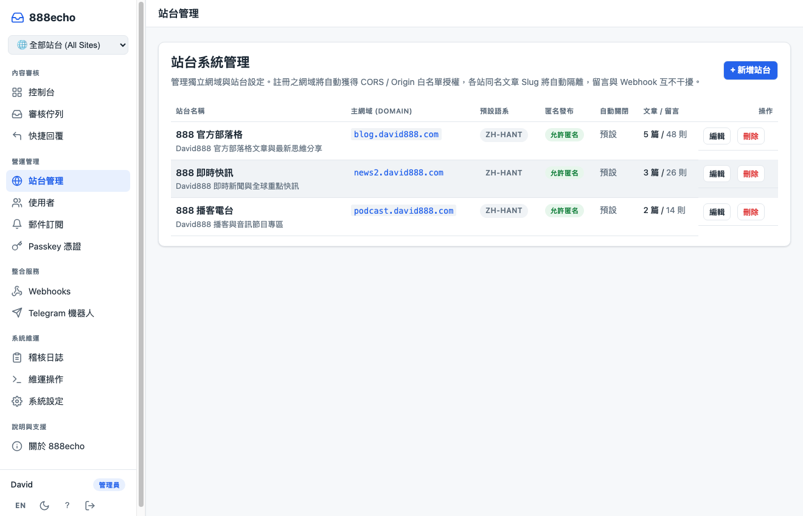
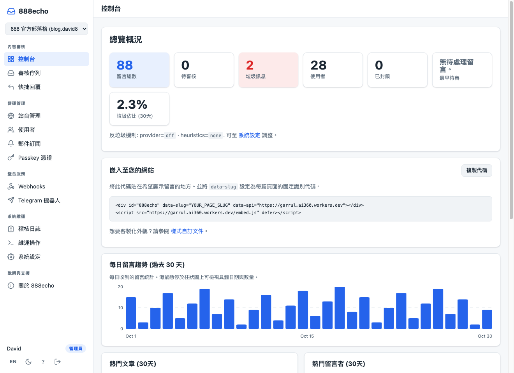
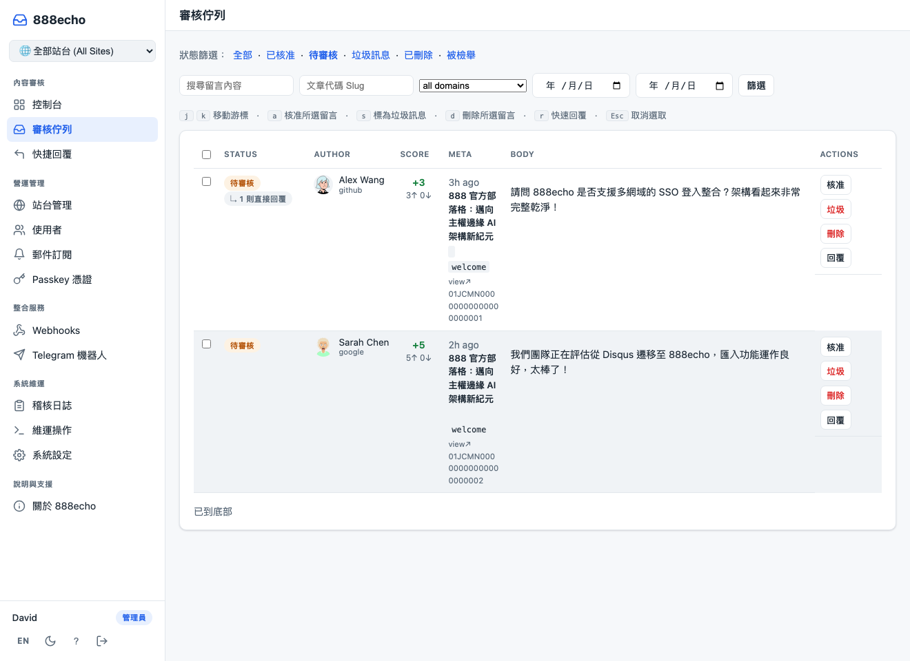

# 888echo

[](LICENSE)
[](https://github.com/tbdavid2019/Garrul/releases)
[](https://github.com/tbdavid2019/Garrul)
[](https://github.com/tbdavid2019/Garrul)

[English](README.md) | **繁體中文**

**888echo** 是一款基於 Cloudflare 邊緣技術（Workers + D1 + KV + Turnstile）構建的高效能、主權自託管留言與社群討論系統。它是 888 開源生態體系（`888echo`、`888box`、`888a2a`、`888quant`）的核心組件。具備 100% 自託管特質、零追蹤代碼（Tracker-free）、無單則留言費用，所有討論資料完整留存在您自己的 Cloudflare 帳戶中。

享有自託管的主權，卻完全告別繁瑣的運維負擔：**無需維護 Docker 容器、無需管理 VPS 主機、無需處理資料庫伺服器**。系統享有零作業系統補丁、零停機焦慮、自動化 TLS 憑證更新，且 Cloudflare D1 自動提供 SQLite 存儲的精準時間點備份。

---

## 🌟 核心特色

- **🌐 系統級多站台架構（Multi-Site Architecture）**：單一 Worker 實例即可集中託管與管理多個獨立網站、網域與子網域（如官方部落格、新聞站、播客電台、技術文件等）。各站台享有獨立文章 Slug 命名空間、D1 資料庫快取的動態 CORS 與 Origin 白名單授權、站台級專屬設定（匿名發文開關、討論串自動關閉天數、預設語言），並在後台側邊欄提供全局站台切換器。
- **💬 強大且優雅的樹狀討論串**：原生支援 Markdown 語法、12 種自選 Emoji 表情回應、可配置的編輯與刪除時限、最新 / 最早 / 最熱門排序即時切換。
- **🔐 零信任免密碼安全登入**：管理後台（`/admin/login`）原生支援 WebAuthn / Passkey（Touch ID、Face ID、安全金鑰硬體認證）及電子郵件 6 位數 OTP 一次性驗證碼登入，杜絕傳統密碼撞庫與洩漏風險。
- **👥 多元第三方登入與訪客留言**：支援 GitHub、Google、Facebook、X (Twitter)、Discord 等 OAuth 第三方帳號登入，亦支援由 Cloudflare Turnstile 人機驗證與頻率限制保護的訪客匿名留言。
- **🎨 Shadow DOM 零污染嵌入元件**：Gzip 壓縮後小於 30 KB，零外部執行時期依賴；透過 CSS Custom Properties 即可輕鬆換膚，樣式與宿主網站 100% 隔離，互不干擾。
- **🏷️ 雙容器向下相容**：嵌入容器支援全新 `<div id="888echo">`，同時 100% 向下相容既有 `<div id="garrul">`。
- **🛡️ 縱深防禦反垃圾架構（Anti-Spam）**：Turnstile 邊緣人機驗證、發文表單時間戳記防偽簽章、邊緣滑動窗口速率限制、嚴苛的 HTML Sanitizer，以及支援萬用字元與邊界的自訂敏感詞詞庫。
- **🔔 即時通知與自動推播**：整合雙備份 Discord Webhook、Slack、Telegram 運維管理員機器人（支援直接在手機上透過行內按鈕進行審核、封鎖或刪除），以及電子郵件討論串訂閱通知。
- **📦 主流留言系統無縫遷移**：內建 Disqus、Remark42、Comentario、isso、Cusdis 等匯入工具，可直接上傳匯出檔快速導入所有歷史文章、留言與作者資料。
- **⚡ 一鍵部署與升級**：執行 `npm run setup` 即可全自動完成資源配置、秘密金鑰綁定、網域設定、資料庫遷移與健康檢查。

---

## 📸 介面預覽

### 多站台系統管理（Multi-Site System Management）
在單一 888echo 實例中輕鬆納管多個獨立網域，靈活配置站台專屬規則，並一覽各站的文章與留言統計：



### 讀者端討論元件（Widget）
透過 Shadow DOM 渲染於宿主網頁中，完全不受宿主 CSS 污染：


### 管理員控制台（Admin Dashboard）
直觀掌握待審留言、總評論數、使用者增長、嵌入程式碼產生器與 30 天留言趨勢：



### 審核佇列（Moderation Queue）
集中批次審核、標記垃圾留言或直接刪除：



> 更多展示（包含暗黑模式、行動版視圖與其他管理頁面），請參閱：[`docs/screenshots.md`](docs/screenshots.md)。

---

## 🏗️ 系統架構

單一 Cloudflare Worker 即可同時驅動前端嵌入 Widget、公共 REST API 與管理員後台介面；並透過 Cron 觸發器自動排程非同步通知與 Webhook 重試：

<picture>
  <source media="(prefers-color-scheme: dark)" srcset="docs/screenshots/architecture-dark.webp">
  
</picture>

- **邊緣執行層**：Cloudflare Workers 提供近乎零冷啟動的全域低延遲運算。
- **主權資料庫**：Cloudflare D1（邊緣 SQLite）儲存所有站台、文章、使用者與留言資料。
- **快取與狀態**：Cloudflare KV 儲存動態系統設定、速率限制狀態與站台快取。
- **人機防護**：Cloudflare Turnstile 阻擋自動化垃圾機器人。
- **詳細架構文件**：請參閱 [`docs/architecture.md`](docs/architecture.md)。

---

## 🚀 快速安裝與部署

生產環境初次部署僅需約 15 分鐘，後續升級只需執行 `npm run upgrade`：

### 1. 免帳戶本機即時預覽（開發模式）
專案內建預先配置的 `.dev.vars.example`（含 Turnstile 開發測試金鑰），無需 Cloudflare 帳戶即可立即在本機運行：

```bash
git clone https://github.com/tbdavid2019/Garrul.git 888echo
cd 888echo
npm install
cp wrangler.example.toml wrangler.toml
cp .dev.vars.example .dev.vars
npm run migrate           # 初始化本機 Miniflare D1 資料庫
npm run dev               # 啟動本機伺服器：http://localhost:8787
```

### 2. 生產環境部署
詳細的前置步驟、OAuth 設定、Turnstile 金鑰、自訂子網域及資料庫遠端遷移，請參閱：
👉 **[`INSTALL.md`](INSTALL.md)**

---

## 💻 網站嵌入整合

在網頁中欲顯示留言框的位置貼上以下代碼（同時支援 `id="888echo"` 與相容舊版的 `id="garrul"`）：

```html
<div
  id="888echo"
  data-slug="my-first-post"
  data-api="https://comments.yourdomain.com"
  data-title="文章標題"
  data-url="https://yourdomain.com/posts/my-first-post/"
  data-published="2026-11-10T12:00:00Z"
  data-lang="zh-Hant"
></div>
<script src="https://comments.yourdomain.com/embed.js" defer></script>
```

### 參數屬性說明

| 屬性 | 必要 | 說明 |
| :--- | :---: | :--- |
| `id` | 是 | 容器識別碼，設定為 `888echo`（或向下相容 `garrul`）。 |
| `data-slug` | 是 | 該篇討論串的唯一識別代碼（在該站台內必須唯一且持久）。 |
| `data-api` | 否 | 888echo Worker 服務的根網址。若與引入的腳本同源可省略。 |
| `data-title` | 否 | 文章標題，用於郵件摘要與管理員後台顯示。 |
| `data-url` | 否 | 文章的永久標準連結（Canonical URL），用於通知與 RSS 饋送。 |
| `data-published` | 否 | 文章發表時間（ISO 8601 格式），用於文章發表過久自動關閉留言計算。 |
| `data-lang` | 否 | 強制指定留言框語系（如 `zh-Hant`、`en`、`ja` 等）。預設會跟隨站台設定或宿主頁面。 |
| `data-mode` | 否 | 設為 `reactions` 時，只會載入頁面級的表情反應列，不載入留言討論串。 |

各前端框架整合範本（Astro, Hugo, Next.js, Jekyll, WordPress, 純 HTML）：請參閱 [`examples/README.md`](examples/README.md)。

---

## 🛠️ 維護與日常營運

- **管理後台登入**：前往 `/admin` 或 `/admin/login`。可使用已註冊的 Passkey（Touch ID、Face ID）或輸入在 `ADMIN_EMAILS` 白名單中的電子信箱收取 6 位數登入碼。
- **多站台管理**：在 `/admin/sites` 可隨時新增、編輯或刪除獨立站台與網域。新增的網域將即時自動獲得 CORS 白名單授權。
- **全域站台切換**：在後台側邊欄頂部的下拉式選單中，可隨時切換至特定站台檢視該站專屬的留言、佇列與統計數據，或選擇「全部站台」宏觀監控。
- **實時日誌監控**：使用 `npx wrangler tail` 查看邊緣即時日誌（絕不記錄敏感個資 PII）。
- **資料庫備份**：執行 `npm run db:export` 可產出 `.sql` 備份檔；或於後台「維護操作」頁面匯出完整 JSON / CSV 檔。
- **完整運維操作指南**：請參閱 [`AGENTS-OPERATE.md`](AGENTS-OPERATE.md)。

---

## 🔒 隱私與合規

888echo 堅守隱私第一（Privacy-First）原則：
- **零分析與追蹤代碼**：絕無 Google Analytics、無 Facebook Pixel、無第三方追蹤廣告，亦不載入 Gravatar。
- **嚴格雜湊防護**：讀者 IP 位址以 HMAC-SHA-256 加鹽雜湊保存，系統永遠不記錄讀者的原始真實 IP。
- **單一嚴格 Cookie**：僅使用一個標記有 `SameSite=None; Secure; Partitioned; HttpOnly` 的必要認證 Cookie。
- **GDPR / CCPA 相容性工具**：管理後台支援單一使用者個資完整匯出與一鍵徹底抹除（Right to be forgotten）。合規範本請參見 [`docs/compliance/`](docs/compliance/)。

---

## 🤝 參與貢獻

歡迎提交 Issue 與 Pull Request！專案規範與代碼架構請參見 [`CONTRIBUTING.md`](CONTRIBUTING.md) 與 [`CLAUDE.md`](CLAUDE.md)。

---

## 📄 授權條款

採用 **GNU Affero General Public License v3.0 (AGPL-3.0)** 開源授權。詳見 [LICENSE](LICENSE) 與 [NOTICE](NOTICE)。
